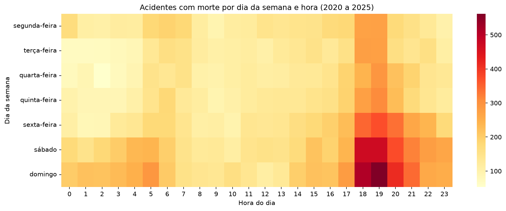
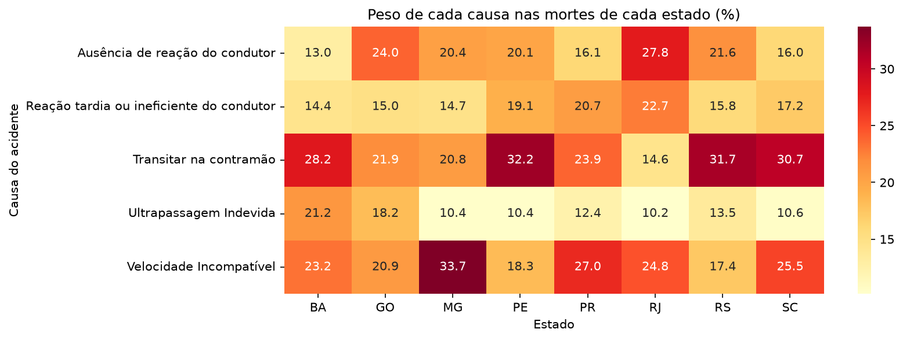

# Acidentes nas Rodovias Federais (PRF)

Projeto de Ciência de Dados seguindo o modelo CRISP-DM.
Disciplina: Ciência de Dados e Aprendizagem de Máquina.

## Objetivo

Usar os dados abertos da PRF para entender **quando** e **por que** acontecem os acidentes com mortes nas rodovias federais. A ideia é que a análise ajude a pensar em onde e em que horários a prevenção e a fiscalização são mais necessárias.

## Critérios de sucesso e objetivos técnicos

**Critérios de sucesso:**
- Responder às duas perguntas com base nos dados da PRF.
- Cada resposta apoiada por pelo menos um gráfico.
- Conclusões escritas sem exagerar o que os números mostram.

**Objetivos técnicos:**
- Preparar os dados de 2020 a 2025 em um único arquivo limpo.
- Contar acidentes com morte por dia da semana e hora.
- Somar mortos por causa e por estado, comparando também a proporção.
- Treinar uma árvore de decisão simples para testar se esses dados preveem mortes.

**Plano do projeto (15 dias):**
Entendimento do negócio e dados, preparação, modelagem, análise das duas perguntas, avaliação e relatório final.

## Perguntas do projeto

**Pergunta 1:** Em que **dia da semana e horário** os acidentes **com mortes** mais acontecem?

**Pergunta 2:** Quais **causas** mais levam a mortes, e isso muda por **estado**?

## Como vamos responder

- Pergunta 1: contar os acidentes com mortes por dia da semana e por hora, e mostrar em um mapa de calor.
- Pergunta 2: somar os mortos por causa e por estado, e comparar em gráfico de barras e mapa de calor.

## Principais resultados

**Pergunta 1:** os acidentes com morte foram mais frequentes aos domingos (5.845) e sábados (5.344), e o horário com mais casos foi às 19h (2.555). Os números contam acidentes e não consideram o fluxo de veículos.



O mapa de calor mostra que as cores mais escuras ficam entre 18h e 19h, principalmente aos sábados e domingos.

**Pergunta 2:** as causas com mais mortos foram transitar na contramão (4.168), velocidade incompatível (3.280) e ausência de reação do condutor (3.262). A causa que mais pesa muda por estado.



O mapa de calor mostra, em porcentagem, quanto cada uma das 5 principais causas pesa nas mortes de cada estado.

Todos os gráficos estão em `dashboard/`.

## Dados

- Fonte: Dados Abertos da PRF (Polícia Rodoviária Federal)
- Link: https://www.gov.br/prf/pt-br/acesso-a-informacao/dados-abertos/dados-abertos-da-prf
- Período previsto: 2020 a 2025
- Formato: CSV "agrupados por ocorrência" (uma linha por acidente)

Os CSVs originais (`datatran2020.csv` a `datatran2025.csv`) ficam em `data/raw/`, sem nenhuma alteração.
Codificação: latin-1. Separador: `;`. Decimal: `,`.

## Estrutura

```
├── data/
│   ├── raw/          dados originais da PRF
│   └── processed/    dados limpos
├── notebooks/        um notebook por fase do CRISP-DM
├── sql/              consultas (se usarmos)
├── dashboard/        prints dos gráficos
├── docs/             relatório e dicionário de dados
├── requirements.txt
└── README.md
```

## Fases do CRISP-DM

| Fase | Notebook | Status |
|------|----------|--------|
| 1. Entendimento do Negócio | `README.md` | concluída |
| 2. Entendimento dos Dados | `02_dados.ipynb` | concluída |
| 3. Preparação dos Dados | `03_preparacao.ipynb` | concluída |
| 4. Modelagem | `04_modelagem.ipynb` | concluída |
| 5. Avaliação | `07_avaliacao.ipynb` | concluída |
| 6. Implementação | `docs/relatorio_final.md` | concluída |

## Gráficos planejados

Mapa de calor, linha e barras horizontais. Não usamos gráfico de pizza.

## Ferramentas

Python, pandas, seaborn, plotly, matplotlib e scikit-learn.

## Autoria

Anna Beatriz Oki e Lucas Fortes.
